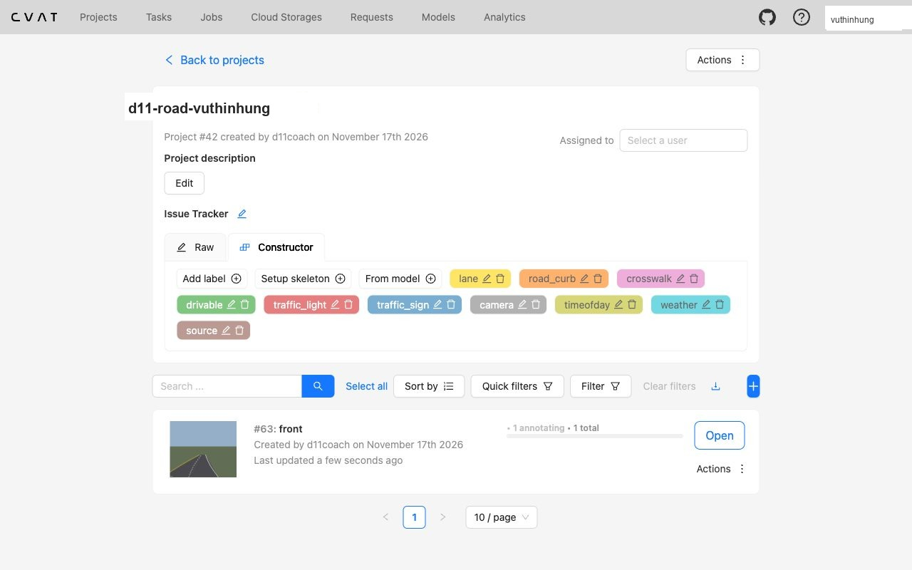
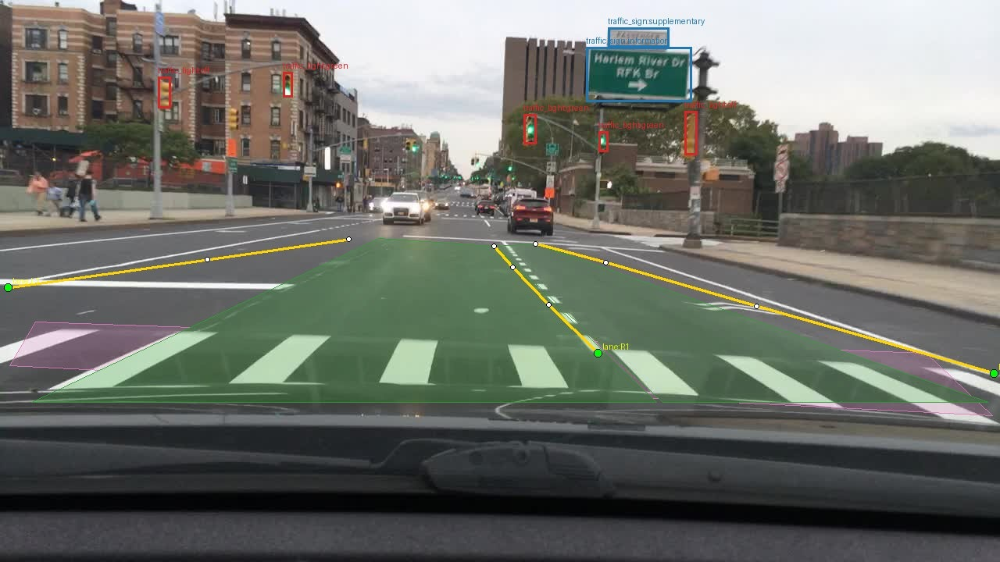
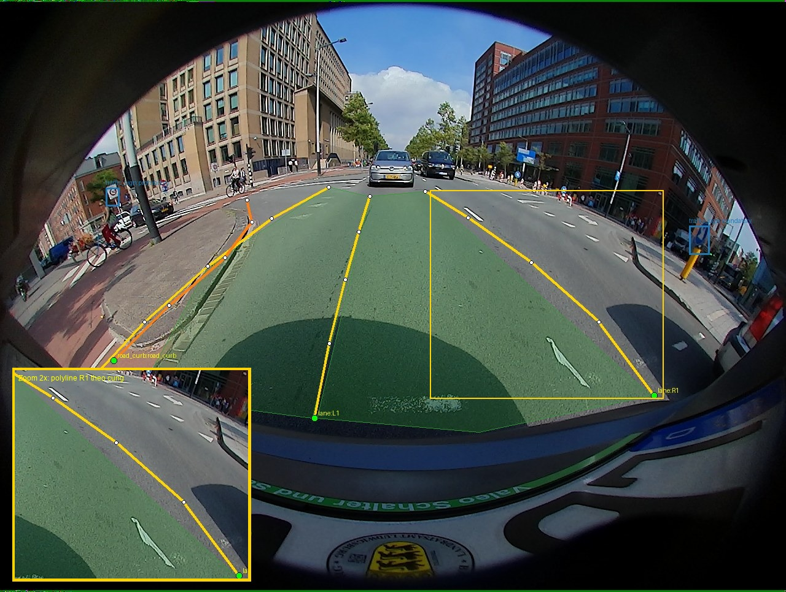
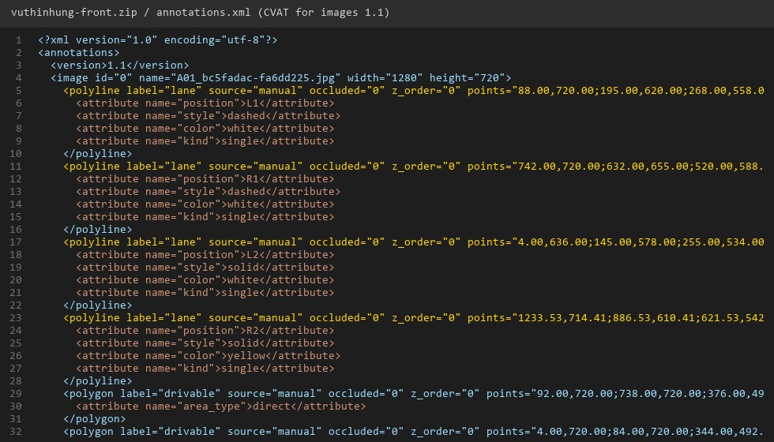

# Báo cáo cá nhân — Ngày 11
Họ tên: Vũ Thị Nhung              Mã học viên: 2A202603156  
Phiên bản CVAT (Help → About): CVAT v2.82.0  
Guideline: Road v1.0    Lần nộp (`revision` trong manifest): `2`  
Thời điểm export (ngày giờ trên CVAT): 20/11/2026 16:32 (UTC+7) / `2026-11-20T14:03:40+00:00`    Số lần nộp lại sau Rework: `1` (bản gốc `revision 1` đã lưu tại `r1/vuthinhung-manifest-r1.json`)  

## 1. Kiểm project
| Mục | Đúng như guideline Road v1.0? | Ghi chú |
| --- | --- | --- |
| 6 label, đúng kiểu | Đúng | `lane` (polyline), `road_curb` (polyline), `crosswalk` (polygon), `drivable` (polygon), `traffic_light` (rectangle), `traffic_sign` (rectangle) khớp 100% với `configs/road_v1_labels.json` |
| Thuộc tính và giá trị | Đúng | Tất cả thuộc tính đều để `mutable=false`; `traffic_light` và `traffic_sign` có thuộc tính checkbox `edge_zone` mặc định `false` |
| 4 tag ảnh | Đúng | 4 label kiểu Tag (`camera`, `timeofday`, `weather`, `source`), mỗi tag có duy nhất 1 thuộc tính select tên `value` để tránh gắn trùng hai giá trị trên cùng một ảnh |

Cách kết thúc polyline trên bản CVAT này: Sau khi click lần lượt các điểm dọc theo tâm vạch từ gần xe (đáy ảnh) tiến ra xa, nhấn phím **`N`** trên bàn phím (hoặc bấm lại nút **Draw new polyline** trên thanh công cụ bên trái) để chốt điểm cuối của đường gấp khúc.  
Cách đặt tag ảnh trên bản CVAT này: Chọn công cụ **Tag** (biểu tượng thẻ nhãn ở thanh bên trái), chọn tên label tag (`camera` đặt đầu tiên, sau đó đến `timeofday`, `weather`, `source`) rồi bấm **Tag**. Ngay sau khi gắn, mở mục **Details** của từng tag trong bảng **Objects** bên phải để chọn lại giá trị thuộc tính `value` (vì CVAT luôn tự gán giá trị đầu tiên trong danh sách như `camera=front`, `timeofday=day`, `weather=clear`, `source=real`).

## 2. Số lượng đã gán
| Task | Ảnh | lane | road_curb | crosswalk | drivable | traffic_light | traffic_sign |
| --- | ---: | ---: | ---: | ---: | ---: | ---: | ---: |
| front (`A01–A12`) | 12 | 29 | 3 | 3 | 20 | 13 | 13 |
| front-extra (đã làm `4` / 4: `A13–A16`) | 4 | 11 | 1 | 2 | 7 | 5 | 3 |
| fisheye (`B01–B08`) | 8 | 13 | 6 | 7 | 9 | 2 | 4 |
| fisheye-extra (đã làm `4` / 4: `B09–B12`) | 4 | 3 | 2 | 3 | 4 | 0 | 1 |
| **Tổng cộng (`vuthinhung-manifest.json`)** | **28** | **56** | **12** | **15** | **40** | **20** | **21** |

*(Ghi chú: Toàn bộ 28/28 ảnh đều đã được gắn đủ 4 tag ảnh `camera`, `timeofday`, `weather`, `source` = 112 tag; tổng cộng 164 shape + 112 tag = 276 nhãn trên cả hai file zip).*

## 3. Bảng ca khó
| Ảnh | Nhãn | Phân vân giữa | Đã chọn | Lý do |
| --- | --- | --- | --- | --- |
| `A05_b2576c8c-2de20b8a.jpg` | `lane` (`L1`, `R1`) | Cố ước lượng vẽ polyline `L1`/`R1` dọc theo hai hàng xe đỗ hay bỏ trống và chỉ vẽ `road_curb` + `drivable` | Không vẽ `L1`/`R1`; chỉ vẽ `road_curb` ở mép vỉa hè phải và `drivable` (`direct`) | Mặt đường nhựa trong khu phố này hoàn toàn không có vạch sơn chia làn. Theo Mục 6 tài liệu hướng dẫn CVAT và CHECKPOINTS, không được vẽ vạch mà ảnh không có; cảnh báo `QC1-02` của `lint` trên ảnh `A05` được Coach xác nhận miễn trừ. |
| `A07_b41ace08-c8468690.jpg` | `lane` (`L1`) và `road_curb` | Mép chân dải phân cách bê tông (Jersey barrier) bên trái làn đang chạy nên gán là `lane` (`L1`) hay `road_curb` | Gán là `road_curb`, không gán `lane` (`L1`) | Sát chân dải phân cách bê tông bên trái không có vệt sơn kẻ đường nào, chỉ có gờ bê tông phân cách nên bản chất là mép đường không sơn (`road_curb`). Bên phải có vạch trắng liền rõ ràng nên vẫn gán `R1` và `R2` bình thường. |
| `A08_c0deebc1-16cfa791.jpg` | `traffic_sign` trên giá long môn | Tấm biển trắng nhỏ `"PASSENGER CARS ONLY"` gắn ngay phía trên biển xanh lá `"Harlem River Dr / RFK Br"` nên gộp chung 1 box hay tách riêng, chọn `group` nào | Tách thành 2 box riêng: biển lớn xanh lá chọn `information`, tấm nhỏ phía trên chọn `supplementary` (trong quá trình tự rà có lúc nhầm giữa `information` và `supplementary`) | Tấm biển nhỏ đi kèm để thuyết minh/giới hạn phạm vi áp dụng cho biển chỉ dẫn chính nên mang chức năng biển phụ (`supplementary`). Dù gắn phía trên thay vì phía dưới, việc tách box riêng giúp detector không học lẫn phần nền trời ở hai góc. |
| `A09_c7e6d5d1-c8af9fe3.jpg` | `lane` (`L1`) ở giữa đường | Vạch đôi màu trắng uốn cong chữ S ở giữa đường nên chọn `color=white, kind=double` hay `color=yellow` theo thói quen vạch tim đường | `position=L1`, `style=solid`, `color=white`, `kind=double` | Quan sát pixel thực tế trên ảnh thì hai nét sơn song song có màu trắng rõ rệt (ảnh chụp đô thị ngoài nước Mỹ lọt trong tập BDD100K). Guideline yêu cầu gán thuộc tính theo đúng thực tế nhìn thấy trên ảnh chứ không suy diễn màu theo quy chuẩn. |
| `A10_b6ff1331-f6d3fba8.jpg` | Cụm 3 tấm biển đỏ-trắng trên cột bên trái | Gộp cả cụm 3 tấm biển `"NO PARKING"` / `"NO STANDING"` trên cùng một cột thành 1 box hay tách từng tấm biển | Tách thành 3 box riêng biệt sát mép từng tấm: 2 tấm trên `group=prohibitory`, tấm dưới cùng `group=supplementary` (`facing=side`) | Mỗi tấm biển là một bảng kim loại độc lập có viền riêng; tấm dưới cùng ghi phạm vi/hướng mũi tên bổ sung cho biển cấm đỗ phía trên. |
| `B11_07282_RV.png` | Các vạch sơn trắng/vàng trong bãi đỗ xe | Các vạch kẻ chéo màu trắng, vạch ô đỗ xe người khuyết tật màu xanh và khung gạch chéo vàng có gán `lane` không | Chỉ gán 1 polyline `lane` (`position=other`) cho vạch dọc giới hạn lối đi và polygon `drivable`; bỏ qua toàn bộ vạch chia ô đỗ xe | Theo Mục 4 Guideline Road v1.0 ("Vạch ô đỗ không gán lane") và ngoài phạm vi của Road v1.0 (ô đỗ xe thuộc bài Ngày 20 Road v1.x). Nếu gán các vạch kẻ ô đỗ thành `lane` sẽ dính lỗi nặng `QC1-03` (vạch thừa không có trong GT). |

## 4. Phiếu QC 1 nhận được
Bạn kiểm lô của tôi: Trần Minh Quân (`tranminhquan`)    Quyết định nhận được: **Rework** (cho bản `revision 1`)  
| Mã lỗi | Số lỗi | Đồng ý? | Đã sửa? |
| --- | ---: | --- | --- |
| `QC1-03` (`position` sai ở camera hai bên) | 1 | Đồng ý (ảnh `B06` camera `fisheye_left` ban đầu quên sửa thuộc tính mặc định nên để `position=L1`) | Đã sửa thành `position=other` trên `B06` (và rà lại toàn bộ `B05–B08`, `B10`, `B12`) |
| `QC1-06` (sai `kind` trên vạch đôi) | 1 | Đồng ý (ảnh `A04` vạch vàng đôi `L1` bị sót giá trị mặc định `kind=single`) | Đã sửa thành `kind=double` |
| `QC1-11` (thiếu `edge_zone` trên ảnh fisheye) | 1 | Đồng ý (ảnh `B02` cụm đèn đỏ bên trái nằm ngoài 80% bán kính nhưng chưa tích `edge_zone`) | Đã sửa thành `edge_zone=true` và kiểm tra lại bằng `road_check lint` |
| `QC1-02` (cảnh báo lint thiếu `L1`/`R1` ở `A05`, `A07`) | 0 (miễn) | Đồng ý với ghi chú của bạn kiểm: ảnh `A05` thực tế không có vạch sơn và `A07` bên trái là dải bê tông không sơn | Giữ nguyên theo xác nhận của Coach, không vẽ bịa thêm vạch |

*(Trước khi sửa trên CVAT và xuất bản mới, tôi đã chép hai file zip cũ cùng manifest lần 1 vào thư mục `r1/vuthinhung-manifest-r1.json`, sau đó xuất lại hai file zip giữ nguyên tên và tạo `vuthinhung-manifest.json` với `--revision 2`).*

## 5. Kiểm file export
| File | Mở lại được? | Số shape ảnh 1 (job / file) | Số shape ảnh 2 (job / file) | Tag camera có trong XML? |
| --- | --- | --- | --- | --- |
| `vuthinhung-front.zip` | Có (`contains_images: false`) | `A01`: 8 / 8 (`4 lane, 3 drivable, 1 sign`) | `A02`: 5 / 5 (`3 lane, 2 drivable`) | Có (`<tag label="camera"><attribute name="value">front</attribute></tag>` trên cả 16/16 ảnh) |
| `vuthinhung-fisheye.zip` | Có (`contains_images: false`) | `B01`: 4 / 4 (`2 lane, 1 crosswalk, 1 drivable`) | `B02`: 7 / 7 (`2 lane, 1 crosswalk, 1 drivable, 2 light, 1 sign`) | Có (`fisheye_front`, `fisheye_rear`, `fisheye_left`, `fisheye_right` khớp hậu tố `FV/RV/MVL/MVR` trên cả 12/12 ảnh) |

## 6. Ảnh chụp màn hình
1. **Tab Labels của project `d11-road-vuthinhung`:**
   
2. **Một ảnh camera trước đã gán đủ (`A08_c0deebc1-16cfa791.jpg` — làn, vùng lái, vạch qua đường, đèn/biển):**
   
3. **Một ảnh fisheye đã gán, phóng to đoạn polyline cong (`B03_04267_RV.png`):**
   
4. **Một đoạn XML có `<polyline label="lane">` trong `annotations.xml`:**
   

## 7. Tự đánh giá
* **Lỗi bạn mắc nhiều nhất hôm nay (theo mã `QC1-xx`), và cách tránh ở Ngày 20:**
  * Lỗi dễ mắc nhất là **`QC1-06` / `QC1-03` / `QC1-09` do cơ chế tự điền giá trị mặc định của CVAT** (mỗi khi vẽ xong một polyline `lane`, CVAT luôn tự gán `L1 / solid / white / single`; hay khi gắn tag `weather` luôn mặc định là `clear`), cùng với **`QC1-04` (độ lệch tâm vạch ở xa > 5 px)** khi vạch sơn mờ dần hoặc cong nhẹ ở cuối đường.
  * **Cách khắc phục ở Ngày 20 (Road v1.x):** Tập thói quen bắt buộc mở sẵn panel **Objects → Details** bên phải và rà ngay 4 thuộc tính (`position`, `style`, `color`, `kind`) trước khi chuyển sang vẽ hình tiếp theo; với ảnh fisheye camera hai bên (`MVL`, `MVR`), đổi ngay `position=other` ngay khi vừa nhấn phím `N`. Khi vẽ polyline ở đoạn xa hoặc cong, phóng to (zoom) lên ít nhất 200% để đặt điểm đúng tâm vệt sơn và chạy `road_check lint` ngay sau khi xong từng nhóm ảnh.
* **Nhãn của bạn đi vào model ở đâu? Chọn một lỗi đã sửa và nói nó làm model học sai thế nào:**
  * Các nhãn `lane`, `drivable`, `traffic_light`, `traffic_sign` đi trực tiếp vào làm **đích giám sát (supervision target / ground-truth tensor)** trong hàm mất mát (loss function) của mạng đa tác vụ nhận thức đường bộ (như mô hình phát hiện làn đường theo cơ chế **row-anchor / segmentation**, phân vùng mặt đường lái được cho hệ thống giữ làn **LKA** và lập kế hoạch quỹ đạo, hoặc detector biển báo/đèn tín hiệu).
  * **Ví dụ lỗi đã sửa:** Ở bản `revision 1`, trên ảnh `B06_04068_MVL.png` (`camera=fisheye_left`), tôi để sót thuộc tính `position=L1` (vạch giới hạn bên trái làn xe đang chạy) cho một vạch kẻ ngang nhìn từ camera sườn trái, trước khi sửa lại thành `position=other` ở bản `revision 2`. Nếu lỗi nặng `QC1-03` này lọt vào tập huấn luyện của hệ thống Surround-View Monitoring (SVM), mô hình sẽ bị **nhiễu loạn ánh xạ hình học không gian (spatial-semantic confusion)**: nó học nhầm một vạch kẻ nằm ngang bên hông xe thành ranh giới làn đường dọc phía trước (`L1`), dẫn tới bộ ước lượng tâm làn (lane-keeping /鳥瞰 BEV fusion) tính sai góc lệch hướng (heading angle) và điều khiển đánh lái sai lệch gây mất an toàn.

## 8. (Tùy chọn, buffer) Từ polyline đến đích row-anchor
Kết quả chạy kiểm chứng bằng `python -m road_lab.rowanchor vuthinhung-front.zip --image A01 --position R1` trên vạch `R1` của ảnh `A01_bc5fadac-fa6dd225.jpg` (so sánh với vạch `R1` trên cùng ảnh `A01` của bạn Trần Minh Quân):

| y | 720 | 680 | 640 | 600 | 560 |
| --- | ---: | ---: | ---: | ---: | ---: |
| x của chúng tôi (`lane#1@(742,720)`) | 742,0 | 674,3 | 606,9 | 540,1 | 474,7 |
| x của bạn kia (`tranminhquan`) | 740,5 | 673,1 | 605,8 | 538,6 | 471,9 |

Trả lời 3 câu:

1. **Năm số x đó chính là đích mà một model row-anchor học cho vạch này. Nếu bạn dừng polyline sớm 40 px, hàng nào đổi thành "không có làn"?**
   * Điểm đầu gần xe là `y = 720` và điểm xa trong bảng neo là `y = 560` (hoặc điểm dừng thực tế của polyline ở `y = 495`). Nếu ở phía gần xe ta bắt đầu muộn hơn 40 px (tức chỉ vẽ từ `y = 680` thay vì `y = 720`) thì hàng **`y = 720`** đổi thành `"không có làn"`. Ngược lại, nếu xét trên lưới 5 hàng neo từ `720` lên `560` mà ta dừng polyline sớm 40 px trước hàng `560` (tức dừng ngay ở `y = 600` thay vì kéo lên tới `y <= 560`), thì hàng **`y = 560`** sẽ nằm ngoài phạm vi nội suy của polyline và đổi thành **`"không có làn"`** (model học nhầm rằng làn đường đã biến mất ở khoảng cách trung bình trước đầu xe).
2. **So với bạn được kiểm (cùng ảnh): ở hàng 720 và hàng 560, hai bạn lệch nhau bao nhiêu pixel? Lệch ở hàng nào ảnh hưởng LKA nhiều hơn (slide 25)?**
   * Ở hàng `y = 720`, hai bạn lệch nhau `|742,0 - 740,5| = 1,5 px`. Ở hàng `y = 560`, hai bạn lệch nhau `|474,7 - 471,9| = 2,8 px`.
   * Tuy nhiên, xét về mặt điều khiển giữ làn (**LKA — Lane Keeping Assist**, slide 25): nếu cùng một độ lệch hoặc xét ảnh hưởng trực tiếp tới việc ước lượng độ lệch ngang tức thời của thân xe (*lateral offset / cross-track error* ngay tại đầu xe), thì **sai số ở hàng gần xe (`y = 720`) ảnh hưởng tới bộ điều khiển LKA tức thời nghiêm trọng hơn** vì đó là điểm neo xác định vị trí hiện tại của xe trong làn (vì vậy Guideline Quy tắc 3 nhấn mạnh: *"Điểm đầu sát xe là điểm quan trọng nhất, đặt thật chính xác"*). Trong khi đó, ở hàng xa (`y = 560`), 1 pixel trên ảnh tương ứng với khoảng cách thực tế ngoài đời lớn hơn nhiều do phép chiếu phối cảnh (perspective projection), nên lệch nhiều pixel ở hàng `y = 560` sẽ làm sai lệch ước lượng độ cong đường phía trước (*look-ahead curvature / heading preview*).
3. **Nếu polyline vẽ từ xa về gần (ngược quy tắc 2), cách tính trên có đổi không? Script nào sẽ gặp khó?**
   * Với phép nội suy tuyến tính đơn thuần `x_at_y(points, y)` trong `rowanchor.py`, công thức duyệt qua từng đoạn thẳng `(x1, y1) - (x2, y2)` và kiểm tra `min(y1, y2) <= y <= max(y1, y2)` nên **kết quả số học `x` tại từng hàng `y` trong `rowanchor.py` không đổi** (dù `rowanchor.py` vẫn phát hiện `first[1] < last[1]` và in dòng cảnh báo *"Chú ý: polyline đầu tiên vẽ từ xa về gần"*).
   * Tuy nhiên, các **script kiểm tra thứ tự hình học theo tham số độ dài cung `s` (arc-length parameterization)** như **`road_check.py`** (`_lanes`: kiểm tra `s1 < s0`, so khớp điểm đầu `pts[0]` với điểm gần xe `g.points[0]` và điểm cuối `pts[-1]` với điểm dừng `g.points[-1]`) cũng như các **pipeline tiền xử lý chuỗi điểm có hướng cho mô hình học sâu** (như spline fitting theo thứ tự điểm từ mũi xe ra xa, hoặc mô hình tự hồi quy dự đoán điểm nối tiếp từ gần ra xa) sẽ bị lỗi hoàn toàn: điểm đầu bị hiểu nhầm thành điểm cuối và bị bắt lỗi `QC1-04` ("vẽ ngược chiều").
